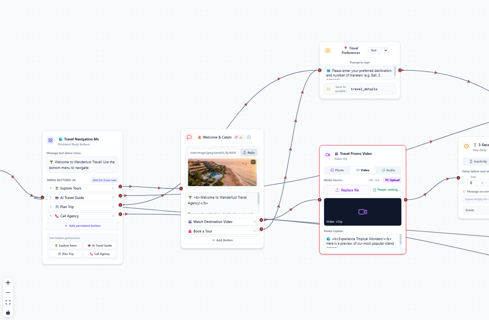
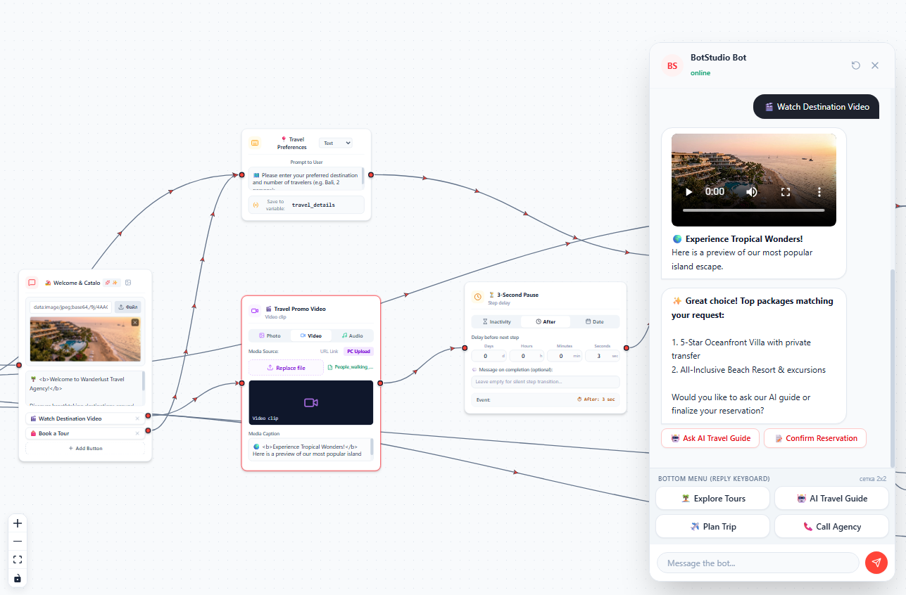
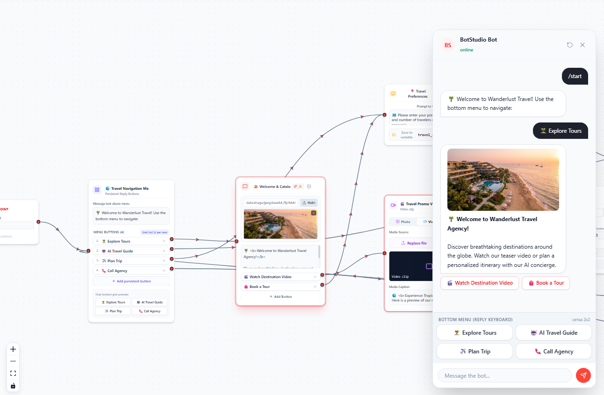
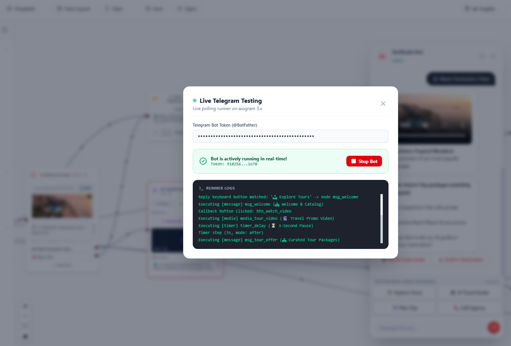
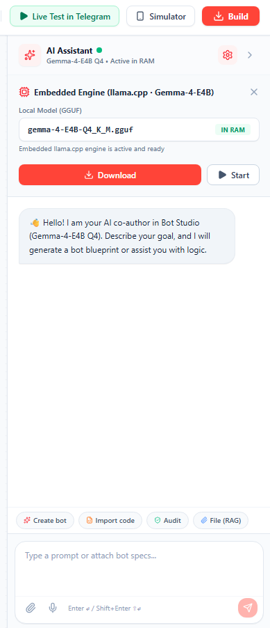

# Bot Studio IDE (v0.5.0 Beta) 🚀

<p align="center">
  
</p>

> **Visual Node-Based IDE & Deterministic Python Compiler for Telegram Bots (`aiogram 3.x`)**  
> *Design Telegram bots visually on an infinite reactive canvas, co-pilot with local offline LLMs (Gemma / Qwen with hardware acceleration), test in a real-time simulator or directly in Telegram, and compile to clean, production-ready standalone asynchronous Python with Zero Vendor Lock-in.*

<p align="center">
  <a href="#"></a>
  <a href="https://img.shields.io/badge/OS-Windows%2010%2F11%20%7C%20Linux%20%7C%20macOS-blue.svg"></a>
  <a href="https://img.shields.io/badge/Hardware-AMD%20Vulkan%20%7C%20NVIDIA%20CUDA%20%7C%20Apple%20Metal%20%7C%20Intel-purple.svg"></a>
  <a href="https://www.python.org/"></a>
  <a href="https://docs.aiogram.dev/"></a>
  <a href="https://react.dev/"></a>
  <a href="#"></a>
  <a href="LICENSE"></a>
</p>

> [!NOTE]
> **Project Status: Public Beta (Early Development Stage)**  
> *Bot Studio is currently in its early beta phase. Core components — including the visual node canvas, deterministic aiogram 3.x compiler, offline simulator, live Telegram runner, and hardware-accelerated local LLM copilot — are active and functional. Because the project is in early development, APIs, schema, and UI layouts may evolve. We actively welcome feedback, suggestions, and GitHub Issues!*

---

## 📸 Workspace & Feature Showcase

### Full-Screen Visual IDE Overview
An intuitive infinite canvas with reactive node connections, visual node inspectors, live state tracing, and built-in Telegram testing tools:

<p align="center">
  
</p>

<br />

### Interactive Visual Canvas & Real-Time Flow
Drag and drop nodes, configure inline buttons, timers, media, and follow dynamic flowing arrows that visualize your bot's conversational path:

<p align="center">
  
</p>

<br />

### Real-Time Offline Simulator & Rich Media Previews
Test your bot instantly without connecting to Telegram or creating bot tokens. The simulator accurately renders Telegram HTML markup, inline keyboards, local/remote images, and full video playback:

<p align="center">
  
  &nbsp;
  
</p>

<br />

### Real Telegram Live Testing
Test directly on your phone or desktop Telegram client in real time. Launch with your `@BotFather` token with a single click:

<p align="center">
  
</p>

<br />

### Embedded AI Copilot with Native Hardware Acceleration
Generate complete bot architectures from text descriptions using an embedded, local `llama.cpp` inference engine running Gemma-4-E4B / Qwen with zero external setup:

<p align="center">
  
  &nbsp;
  
</p>

---

## ⚡ Cross-Platform & Hardware Acceleration Matrix

Bot Studio includes an embedded high-performance **`llama.cpp`** local inference engine. It automatically identifies your operating system, CPU architecture, and graphics hardware to select the optimal acceleration backend:

| Hardware & Platform | Acceleration Engine | Offload Mode | Performance |
| :--- | :--- | :--- | :--- |
| **AMD (Radeon 780M / 680M / Vega iGPU & RX dGPU)** | **Vulkan API** (`llama-vulkan`) | Fully offloaded (`-ngl 99`) | ⚡ High |
| **NVIDIA (GeForce GTX / RTX 20/30/40/50-series)** | **CUDA** (`llama-cuda` cu12) | Fully offloaded (`-ngl 99`) | 🚀 Ultra |
| **Intel (Iris Xe / UHD Graphics & Arc dGPU)** | **Vulkan API** (`llama-vulkan`) | Fully offloaded (`-ngl 99`) | ⚡ High |
| **Apple Silicon (Mac M1, M2, M3, M4)** | **Metal API** (`llama-metal`) | Unified Memory offload | 🚀 Ultra |
| **CPU Only (Any AMD Ryzen, Intel Core, ARM)** | **AVX2 / AVX-512 / NEON** | Multithreaded CPU (`-t 8`) | 🟢 Efficient (~2.5 GB RAM) |

### Supported Operating Systems:
- **Windows 11 / Windows 10 (64-bit)**: 100% native support (Vulkan, CUDA, CPU).
- **Linux (Ubuntu, Debian, Fedora, Arch, etc.)**: 100% native support (Vulkan, CUDA, ROCm, CPU).
- **macOS (Apple Silicon & Intel)**: 100% native support (Metal & AVX2).
- *Legacy Windows Note:* Windows 7 is officially unsupported by modern Python (>=3.9) and Node.js. For Windows 7 machines, we recommend compiling the bot on a modern machine or running the generated bot in Docker / cloud.

---

## 🚀 1-Click Quickstart

### 🪟 Windows (10 / 11)
Simply double-click **`start_windows.bat`** (or `start.bat`).  
The launcher will automatically:
1. Verify Python 3.10+ and Node.js.
2. Install any missing dependencies.
3. Auto-detect your GPU (AMD, NVIDIA, Intel).
4. Launch the Backend (`http://127.0.0.1:8000`) & Frontend (`http://127.0.0.1:5173`).
5. Open your default web browser directly into Bot Studio!

### 🐧 Linux & 🍎 macOS
Open your terminal in the project folder and run:
```bash
chmod +x start_linux_mac.sh
./start_linux_mac.sh
```

### 🐳 Docker & Docker Compose
To run Bot Studio completely containerized without installing Python or Node.js locally:
```bash
docker compose up --build
```
Open **`http://localhost:5173`** in your browser.

---

## 🌟 Key Features

- **Full Internationalization (i18n) in 9 Languages:**
  - Supported languages: **English, Русский, Français, Deutsch, Español, 日本語, 한국어, Português, Italiano**.
  - Automatic browser language detection (`navigator.languages`) on first launch.
  - Seamless instant switching across all interface labels, node inspectors, and system tooltips.
- **Inline Canvas Editing:**
  - Edit message texts, button labels, timer delays, variables, and API settings directly inside the visual cards on the canvas.
- **Animated Data Flow Indicators:**
  - Dynamic flowing arrow markers glide across connections, visually tracing execution routes and conversation branches.
- **Embedded AI Copilot (Gemma-4-E4B Q4):**
  - **Embedded llama.cpp:** Runs directly from the project directory without requiring third-party runtime installs.
  - **Hardware Acceleration:** Native Vulkan for AMD/Intel, CUDA for NVIDIA, Metal for Apple Silicon, or optimized AVX2 CPU threads.
  - **✨ Prompt-to-Bot Generation:** Enter a natural language prompt and receive a structured node graph with automated clean layout.
  - **📁 Document RAG Knowledge Base:** Upload PDF and DOCX files to ground your bot's answers in custom documentation.
- **Zero Vendor Lock-in (100% Standalone Code):**
  - Clicking **Build** compiles your visual canvas into a standalone, clean asynchronous `aiogram 3.x` project (`bot.py`, `handlers.py`, `keyboards.py`, `states.py`, `texts.yaml`, `requirements.txt`, `Dockerfile`, `render.yaml`).
- **Offline Simulator & Graph Tracing:**
  - Built-in interactive Telegram chat window with real-time active node highlighting as conversations progress.
- **Live Test in Real Telegram:**
  - Background live test runner using your `@BotFather` token for immediate verification on smartphones and desktops.
- **1-Click Render.com Cloud Deployment:**
  - Pre-configured `render.yaml` enables free 24/7 cloud deployment without terminal commands.

---

## 🛠 Visual Node Palette (10 Core Nodes)

| Node | Purpose | Canvas & Runtime Capabilities |
| :--- | :--- | :--- |
| **🚀 Start / Command** | Bot entry point via commands (`/start`, `/help`) | Command name, description, entry-point routing |
| **💬 Message** | Sends text, images, and inline keyboards | Full HTML formatting, local/remote image attachment, dynamic inline button rows, AI text polishing ✨ |
| **⌨️ Bottom Menu (Keyboard)** | Persistent Telegram reply keyboard at bottom of chat | Adaptive grid layouts (full-width, 2 per row, 2x2 grid), individual routing ports per button |
| **⏳ Timer / Delay** | Non-blocking pauses and delays | Days, hours, minutes, seconds delay, silent mode or optional custom notification message |
| **🖼 Multimedia** | Sends photos, videos, or audio | File picker or direct URL, automatic media buffering for Telegram, custom caption |
| **🤖 AI Assistant** | Local or cloud neural network integration | Gateway URL, model selector, API key, system prompt, greeting, anti-spam rate limiting |
| **📥 User Input (FSM)** | Finite State Machine user input collection | Variable naming, input type validation (text, number, phone, email), customizable error prompts |
| **📊 Sheets / Database** | Lead capture and client database storage | Local CSV or SQLite storage, client history tracking, automated row appending |
| **🔔 Admin Notification** | Direct alert delivery to the administrator's Telegram DM | Administrator User ID, message template with dynamic `{variable}` interpolation |
| **🐍 Custom Python** | Arbitrary asynchronous Python execution block | Built-in code editor, direct access to `aiogram 3.x` `state`, `message`, and context objects |

---

## 👥 Contributors & Contact

- **Markus Marrei (Маркус Маррей)** — *Project Author, Lead Architect & Maintainer*
  - GitHub: [@MarkusMarrei](https://github.com/MarkusMarrei)
  - Email: [markus.marrei@gmail.com](mailto:markus.marrei@gmail.com)

Contributions, feature requests, and issue reports are warmly welcomed! Please feel free to open an issue or pull request.

---

## 📄 License

This project is licensed under the **Apache License 2.0** — see the [LICENSE](LICENSE) file for complete details.

```
Copyright 2026 Markus Marrei (Маркус Маррей)

Licensed under the Apache License, Version 2.0 (the "License");
you may not use this file except in compliance with the License.
You may obtain a copy of the License at

    http://www.apache.org/licenses/LICENSE-2.0

Unless required by applicable law or agreed to in writing, software
distributed under the License is distributed on an "AS IS" BASIS,
WITHOUT WARRANTIES OR CONDITIONS OF ANY KIND, either express or implied.
See the License for the specific language governing permissions and
limitations under the License.
```

---

> *Disclaimer: Bot Studio is an independent open-source project and is not affiliated, sponsored, or endorsed by Telegram FZ-LLC, Unity Technologies, or Google LLC.*
