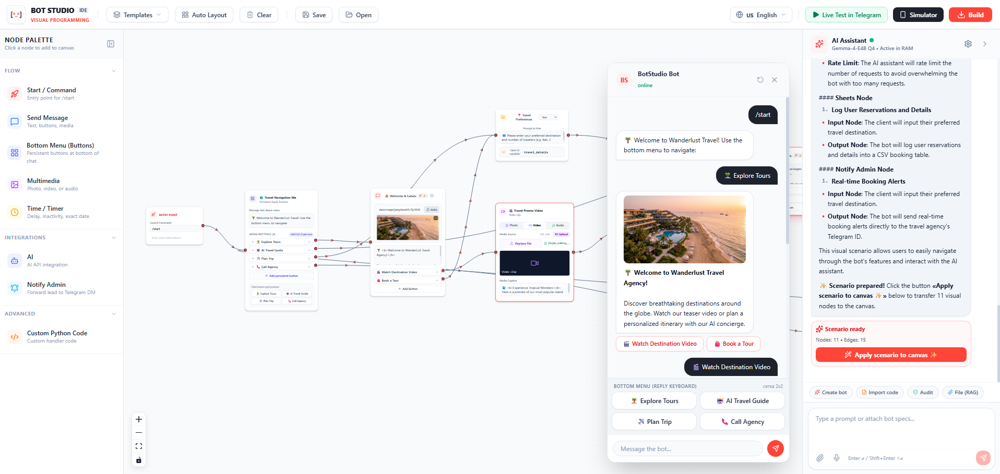
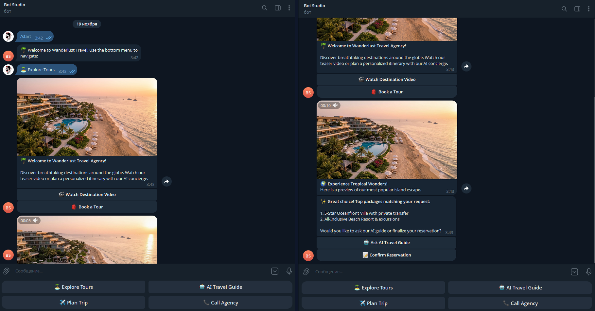

# Bot Studio IDE — Visual Telegram Bot Builder & Python Compiler (aiogram 3.x) 🚀

<p align="center">
  
</p>

> **The Open-Source Visual Node-Based IDE & Deterministic Python Compiler for Telegram Bots (`aiogram 3.x`)**  
> *Design complex conversational flows visually on an infinite reactive canvas, test instantly in an offline simulator or directly in Telegram, co-pilot with local hardware-accelerated LLMs (Gemma / Qwen via embedded `llama.cpp`), and compile to clean, production-ready, standalone asynchronous Python with Zero Vendor Lock-in.*

<p align="center">
  <a href="#"></a>
  <a href="https://img.shields.io/badge/OS-Windows%2010%2F11%20%7C%20Linux%20%7C%20macOS-blue.svg"></a>
  <a href="https://img.shields.io/badge/Hardware-AMD%20Vulkan%20%7C%20NVIDIA%20CUDA%20%7C%20Apple%20Metal%20%7C%20Intel-purple.svg"></a>
  <a href="https://www.python.org/"></a>
  <a href="https://docs.aiogram.dev/"></a>
  <a href="https://react.dev/"></a>
  <a href="#"></a>
  <a href="LICENSE"></a>
</p>

> [!NOTE]
> **Project Status: Public Beta (Early Development Stage)**  
> *Bot Studio is currently in public beta. Core modules — visual node canvas, deterministic aiogram 3.x code compiler, offline media simulator, live Telegram polling runner, and hardware-accelerated local LLM copilot — are fully functional. Because the project is in active early development, schemas and UI features continue to improve. Feedback, issue reports, and contributions are welcome!*

---

## 📸 Workspace Showcase & Visual Tour

### 1. Full-Screen Visual IDE Overview
An intuitive, infinite drag-and-drop workspace with real-time reactive connections, customizable node palettes, contextual sidebars, and integrated testing tools:

<p align="center">
  
</p>

<br />

### 2. Reactive Canvas & Flow-Based Node Architecture
Compose rich conversation logic with inline message editing, button matrices, non-blocking delay timers, and dynamic flowing arrow indicators that visually trace your bot's execution branch:

<p align="center">
  
</p>

<br />

### 3. Real-Time Offline Simulator (Rich Media & Video Previews)
Test your bot's logic and user experience immediately without creating a bot token or connecting to the internet. The built-in simulator faithfully renders Telegram HTML markup, inline button rows, reply menus, local/web images, and smooth video playback:

<p align="center">
  
  &nbsp;
  
</p>

<br />

### 4. Real Telegram Live Testing (Real-Time Polling)
Verify your bot directly inside the official Telegram client on iOS, Android, macOS, Windows, or Web. Launch the background polling runner with a single click using your `@BotFather` token:

<p align="center">
  
</p>

<br />

### 5. Live Execution Runner & Embedded AI Copilot
Monitor live execution logs as user interactions stream through your flow, and configure the embedded offline `llama.cpp` engine to generate bot blueprints from natural language prompts:

<p align="center">
  
  &nbsp;
  
</p>

---

## ⚡ Cross-Platform & Hardware Acceleration Matrix

Bot Studio integrates an embedded, standalone **`llama.cpp`** local inference engine. At startup, it automatically identifies your operating system, CPU architecture, and graphics hardware to select the optimal acceleration backend:

| Hardware Platform | Acceleration Backend | Offload Mode | Performance |
| :--- | :--- | :--- | :--- |
| **AMD (Radeon 780M / 680M / Vega iGPU & RX dGPU)** | **Vulkan API** (`llama-vulkan`) | Fully offloaded to GPU (`-ngl 99`) | ⚡ High |
| **NVIDIA (GeForce GTX / RTX 20/30/40/50-series)** | **CUDA** (`llama-cuda` cu12) | Fully offloaded to GPU (`-ngl 99`) | 🚀 Ultra |
| **Intel (Iris Xe / UHD Graphics & Arc dGPU)** | **Vulkan API** (`llama-vulkan`) | Fully offloaded to GPU (`-ngl 99`) | ⚡ High |
| **Apple Silicon (Mac M1, M2, M3, M4)** | **Metal API** (`llama-metal`) | Unified Memory offload | 🚀 Ultra |
| **CPU Only (Any AMD Ryzen, Intel Core, ARM)** | **AVX2 / AVX-512 / NEON** | Multithreaded CPU (`-t 8`) | 🟢 Efficient (~2.5 GB RAM) |

### Supported Operating Systems:
- **Windows 11 / Windows 10 (64-bit)**: 100% native support (Vulkan, CUDA, CPU).
- **Linux (Ubuntu, Debian, Fedora, Arch, etc.)**: 100% native support (Vulkan, CUDA, ROCm, CPU).
- **macOS (Apple Silicon & Intel)**: 100% native support (Metal & AVX2).
- *Legacy Windows Note:* Windows 7 is unsupported by modern Python (>=3.9) and Node.js. For Windows 7 machines, we recommend compiling the bot on a modern machine or running the generated bot in Docker.

---

## 🚀 1-Click Quickstart

### 🪟 Windows (10 / 11)
Double-click **`start_windows.bat`** (or `start.bat`).  
The launcher will automatically:
1. Verify Python 3.10+ and Node.js.
2. Install any missing dependencies.
3. Detect your GPU (AMD, NVIDIA, Intel).
4. Launch the Backend (`http://127.0.0.1:8000`) & Frontend (`http://127.0.0.1:5173`).
5. Open your default web browser directly into Bot Studio.

### 🐧 Linux & 🍎 macOS
Open your terminal in the project directory:
```bash
chmod +x start_linux_mac.sh
./start_linux_mac.sh
```

### 🐳 Docker & Docker Compose
To run Bot Studio completely containerized without local Python or Node.js installations:
```bash
docker compose up --build
```
Open **`http://localhost:5173`** in your browser.

---

## 🌟 Key Features & Architectural Highlights

- **Full Internationalization (i18n) Across 9 Languages:**
  - Supported languages: **English, Русский, Français, Deutsch, Español, 日本語, 한국어, Português, Italiano**.
  - Automatic browser locale detection (`navigator.languages`) on first launch.
  - Seamless instant switching across all interface labels, node inspectors, and tooltips.
- **Inline Canvas Editing:**
  - Edit message texts, button labels, timer delays, variables, and API settings directly inside the visual cards on the canvas.
- **Animated Data Flow Indicators:**
  - Dynamic flowing arrow markers glide across connections, visually tracing execution routes and conversation branches.
- **Embedded AI Copilot (Gemma-4-E4B Q4):**
  - **Embedded llama.cpp:** Runs directly from the project directory without requiring third-party runtime installs.
  - **Hardware Acceleration:** Native Vulkan for AMD/Intel, CUDA for NVIDIA, Metal for Apple Silicon, or optimized AVX2 CPU threads.
  - **✨ Prompt-to-Bot Generation:** Enter a natural language prompt and receive a structured node graph with automated clean layout.
  - **📁 Document RAG Knowledge Base:** Upload PDF and DOCX files to ground your bot's answers in custom documentation.
- **Zero Vendor Lock-in (100% Standalone Code):**
  - Clicking **Build** compiles your visual canvas into a standalone, clean asynchronous `aiogram 3.x` project (`bot.py`, `handlers.py`, `keyboards.py`, `states.py`, `texts.yaml`, `requirements.txt`, `Dockerfile`, `render.yaml`).
- **Offline Simulator & Graph Tracing:**
  - Built-in interactive Telegram chat window with real-time active node highlighting as conversations progress.
- **Live Test in Real Telegram:**
  - Background live test runner using your `@BotFather` token for immediate verification on smartphones and desktops.
- **1-Click Render.com Cloud Deployment:**
  - Pre-configured `render.yaml` enables free 24/7 cloud deployment without terminal commands.

---

## 🛠 Visual Node Palette (10 Core Nodes)

| Node | Category | Runtime & Canvas Capabilities |
| :--- | :--- | :--- |
| **🚀 Start / Command** | Flow Entry | Triggers execution via commands (`/start`, `/help`, custom commands) |
| **💬 Message** | Interaction | Sends formatted HTML text, local/remote image attachment, dynamic inline button rows, AI text polishing ✨ |
| **⌨️ Bottom Menu (Keyboard)** | Interaction | Persistent Telegram reply keyboard with adaptive grid layouts (full-width, 2 per row, 2x2 grid) and per-button routing ports |
| **⏳ Timer / Delay** | Control Flow | Non-blocking pauses (days, hours, minutes, seconds), silent mode or custom status notification |
| **🖼 Multimedia** | Media | Sends photos, videos, or audio with automatic media buffering for Telegram and custom captions |
| **🤖 AI Assistant** | Intelligence | Local or cloud neural network integration with customizable system prompts, greetings, and anti-spam limits |
| **📥 User Input (FSM)** | State Machine | Captures user responses into FSM states with type validation (text, number, phone, email) and custom retry errors |
| **📊 Sheets / Database** | Data Storage | Automated lead capture into local CSV or database storage with customer interaction history |
| **🔔 Admin Notification** | Alerts | Real-time direct alert delivery to administrator's Telegram DM with `{variable}` interpolation |
| **🐍 Custom Python** | Extensibility | Executes custom asynchronous Python blocks with direct access to `aiogram 3.x` `state`, `message`, and context |

---

## 🏷️ GitHub Topics & Keywords

To make this project easily discoverable by developers and teams searching on GitHub and search engines, the following topics are recommended:

`telegram-bot` · `aiogram` · `aiogram3` · `visual-programming` · `node-editor` · `bot-builder` · `python` · `react` · `flow-based-programming` · `local-llm` · `llama-cpp` · `gemma` · `vulkan` · `cuda` · `low-code` · `no-code` · `telegram` · `developer-tools` · `rag` · `cross-platform`

---

## 👥 Contributors & Contact

- **Markus Marrei (Маркус Маррей)** — *Project Author, Lead Architect & Maintainer*
  - GitHub: [@MarkusMarrei](https://github.com/MarkusMarrei)
  - Email: [markus.marrei@gmail.com](mailto:markus.marrei@gmail.com)

Contributions, feature requests, and issue reports are warmly welcomed! Please feel free to open an issue or pull request.

---

## 📄 License

This project is licensed under the **Apache License 2.0** — see the [LICENSE](LICENSE) file for complete details.

```
Copyright 2026 Markus Marrei (Маркус Маррей)

Licensed under the Apache License, Version 2.0 (the "License");
you may not use this file except in compliance with the License.
You may obtain a copy of the License at

    http://www.apache.org/licenses/LICENSE-2.0

Unless required by applicable law or agreed to in writing, software
distributed under the License is distributed on an "AS IS" BASIS,
WITHOUT WARRANTIES OR CONDITIONS OF ANY KIND, either express or implied.
See the License for the specific language governing permissions and
limitations under the License.
```

---

> *Disclaimer: Bot Studio is an independent open-source project and is not affiliated, sponsored, or endorsed by Telegram FZ-LLC, Unity Technologies, or Google LLC.*
